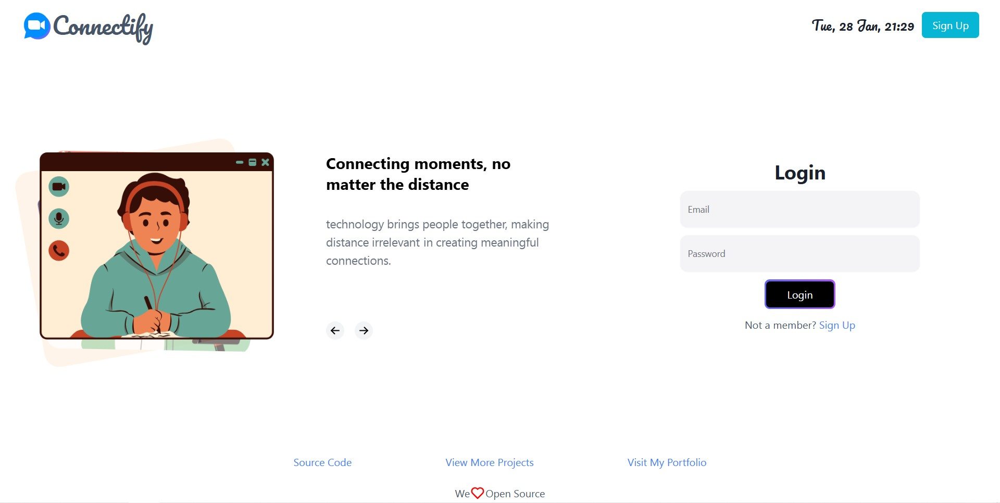

# PeerLink

PeerLink is a modern, real-time peer-to-peer video calling and messaging web application built with **React**, **TypeScript**, **Node.js/Express**, **WebRTC**, **WebSockets**, and **MongoDB**.



---

## 🚀 Key Features

- **Peer-to-Peer Video Calling (WebRTC)**: Direct low-latency peer-to-peer audio and video communication without media routing servers.
- **Real-Time WebSocket Signaling**: Instant exchange of call offers, answers, and ICE candidates via WebSockets.
- **Secure Authentication**: JWT authentication stored in HTTP-only cookies with hashed passwords (`bcryptjs`).
- **Contact Management & Requests**: User discovery via email, incoming/outgoing contact requests, and contact lists.
- **Modern Responsive Interface**: Built with React, Tailwind CSS, Framer Motion, Recoil, Chakra UI, and NextUI.

---

## 🛠️ Tech Stack

| Component | Technologies |
|---|---|
| **Frontend** | React 18, TypeScript, Vite, Tailwind CSS, Recoil, Chakra UI, NextUI, Framer Motion, Axios |
| **Backend** | Node.js, Express, TypeScript, WebSockets (`ws`), Mongoose, JWT, bcryptjs, Zod |
| **Database** | MongoDB |
| **Containerization** | Docker |

---

## 📦 Project Structure

```
PeerLink/
├── backend/            # Express & WebSocket server (TypeScript)
│   ├── src/
│   │   ├── middleware/ # Authentication middleware
│   │   ├── routes/     # API routes (auth, user, contacts, requests)
│   │   ├── utils/      # Database & JWT helpers
│   │   ├── ws/         # WebSocket signaling server
│   │   └── server.ts   # Entry point
│   └── .env.example
├── frontend/           # React + Vite frontend (TypeScript)
│   ├── src/
│   │   ├── component/  # UI components (Auth, Dashboard, VideoCall, etc.)
│   │   ├── recoil/     # Global state management
│   │   └── App.tsx
│   └── .env.example
├── images/             # Documentation & architecture diagrams
└── README.md
```

---

## ⚡ Quick Start (Local Development)

### 1. Prerequisites
- **Node.js** (v18+ recommended)
- **npm**
- **MongoDB** (running locally or via MongoDB Atlas connection string)

### 2. Environment Setup

#### Backend Setup:
Navigate to the `backend/` directory, copy `.env.example` to `.env`:
```bash
cd backend
cp .env.example .env
```
Configure your `.env` values:
```env
PORT=3000
DATABASE=mongodb://localhost:27017/peerlink
SECRET_KEY=your_custom_jwt_secret_key
CLIENT_ORIGIN=http://localhost:5173
```

#### TURN relay for calls across networks

Create a TURN key in [Cloudflare Realtime](https://developers.cloudflare.com/realtime/turn/generate-credentials/).
Add the key ID and its API token to `backend/.env` locally or to your Render service's
environment variables:

```env
CLOUDFLARE_TURN_KEY_ID=your_turn_key_id
CLOUDFLARE_TURN_API_TOKEN=your_turn_key_api_token
```

Keep these values on the backend; do not put them in `VITE_` variables or commit
them. The authenticated `/api/ice-servers` endpoint generates temporary credentials
valid for 24 hours. Calls longer than that require fresh credentials and a new call.
The browser tries a direct connection and can use the TURN relay when needed.

With both variables empty, calls use the existing Google STUN servers only. This
can fail across restrictive networks. A partial configuration or a failed
Cloudflare request returns a call setup error rather than silently disabling TURN.

After configuring and deploying, test with two accounts on different networks.
In Chrome's `chrome://webrtc-internals`, inspect the selected ICE candidate pair;
a candidate type of `relay` confirms TURN is carrying the call. Check Cloudflare's
TURN usage dashboard as well. Mocked tests do not verify live relay connectivity.

#### Frontend Setup:
Navigate to the `frontend/` directory, copy `.env.example` to `.env` (optional for dev server proxying):
```bash
cd frontend
cp .env.example .env
```
Values for `.env`:
```env
VITE_API_URL=http://localhost:3000
VITE_WS_URL=ws://localhost:3000
```

---

### 3. Install & Run

#### Option A: Run Backend & Frontend Separately (Recommended for Development)

1. **Start Backend**:
   ```bash
   cd backend
   npm install
   npm run dev
   ```
   The backend server will start at `http://localhost:3000`.

2. **Start Frontend**:
   ```bash
   cd frontend
   npm install
   npm run dev
   ```
   The Vite dev server will start at `http://localhost:5173`.

#### Option B: Build Frontend into Backend (Production-Style Local Execution)

1. Build frontend:
   ```bash
   cd frontend
   npm install
   npm run build
   ```

2. Build & run backend:
   ```bash
   cd ../backend
   npm install
   npm run build
   npm start
   ```
   Open `http://localhost:3000` in your browser.

---

## 🐳 Docker Setup (Local)

You can also run the entire application using Docker:

```bash
# Build the Docker image
docker build -t peerlink .

# Run the container
docker run -p 3000:3000 -e DATABASE="mongodb://host.docker.internal:27017/peerlink" -e SECRET_KEY="your_secret" peerlink
```

---

## 📜 License & Attribution

This project is open source and licensed under the [GNU General Public License v3.0](LICENSE).

---

## 🔗 Repository

- **GitHub Repository**: [https://github.com/nishant203code/PeerLink.git](https://github.com/nishant203code/PeerLink.git)
